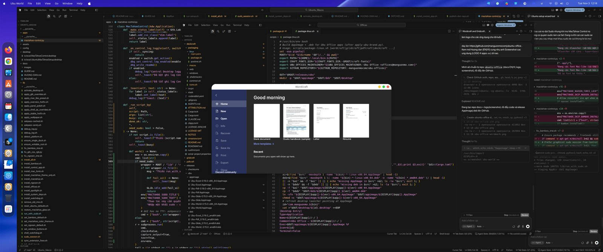
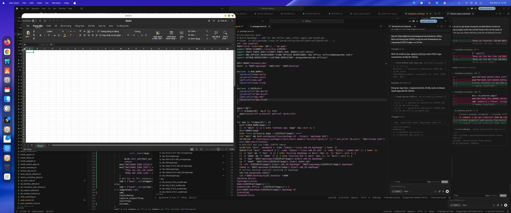
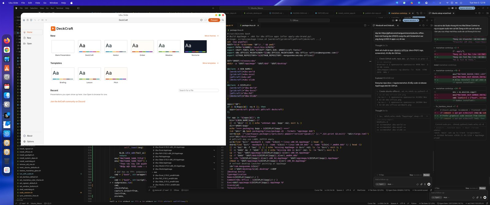
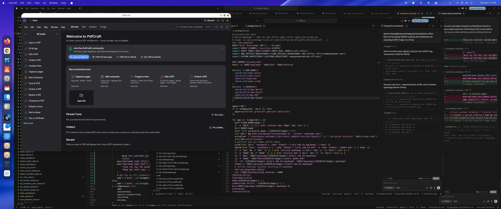

# Ubu Office — User guide (English)

> [🇻🇳 Hướng Dẫn (VI)](HUONG-DAN.md) · [README](README.md) · [⬇ Releases](https://github.com/manguonmocom/ubuntu-office/releases/latest)

**Ubu Office** is a free, open-source office suite for Ubuntu and other Linux desktops:

| App | Purpose | Formats |
|-----|---------|---------|
| **Ubu World** | Word processor | `.docx`, ODT, RTF, … |
| **Ubu Excel** | Spreadsheet | `.xlsx`, CSV, … |
| **Ubu Slide** | Presentations | `.pptx` |
| **Ubu Pdf** | PDF reader / editor | `.pdf` |

- Apps **default to English**.
- The **Setup Wizard** can set Vietnamese (or another language) for first launch.
- Files stay on your computer — no cloud account required.

---

## Option 1 — Setup Wizard AppImage (recommended)

No Python required. Needs Ubuntu Desktop `zenity` (usually preinstalled).

### Steps

1. Open the [latest Release](https://github.com/manguonmocom/ubuntu-office/releases/latest).
2. Download **`Ubu-Office-Setup-*-x86_64.AppImage`**.
3. Right-click → **Properties** → enable **“Allow executing file as program”**.  
   Or:

   ```bash
   chmod +x Ubu-Office-Setup-*-x86_64.AppImage
   ```

4. Double-click the Setup AppImage (or run it from a terminal).
5. Choose **UI language** (wizard default: Vietnamese).
6. Tick apps to install (default: **all four**).
7. Confirm — the wizard downloads/installs AppImages, creates menu shortcuts, and writes `~/.config/ubu-office/language`.

Then launch **Ubu World / Excel / Pdf / Slide** from the app menu.

> Missing zenity? `sudo apt install zenity`

---

## Option 2 — Bash (CLI), no GUI

```bash
git clone https://github.com/manguonmocom/ubuntu-office.git
cd ubuntu-office/setup-wizard

# All four apps, Vietnamese first-run language
./install.sh --lang vi --apps world,excel,pdf,slide

# World + Excel only, English
./install.sh --lang en --apps world,excel

# Use already-downloaded packages
./install.sh --lang vi --apps world,excel,pdf,slide --source /path/to/releases/ubu
```

Interactive zenity wizard:

```bash
./wizard.sh
```

| Variable | Meaning |
|----------|---------|
| `UBU_OFFICE_LANG` | Language code (`vi`, `en`, …) |
| `UBU_OFFICE_APPS` | `world,excel,pdf,slide` |
| `UBU_OFFICE_SOURCE` | Folder containing `appimage/` |

The installer writes:

- `~/.config/ubu-office/language` — suite language (used on first run if an app has no own prefs)
- `~/.local/share/ubu-office/bin/Ubu-*.AppImage`
- desktop entries under `~/.local/share/applications/`
- symlinks in `~/.local/bin/`

---

## Option 3 — Per-app AppImage (manual)

Download each `Ubu-*-x86_64.AppImage`, mark executable, double-click.

```bash
chmod +x Ubu-World-*-x86_64.AppImage
./Ubu-World-*-x86_64.AppImage
```

Force Vietnamese without the wizard:

```bash
mkdir -p ~/.config/ubu-office
echo vi > ~/.config/ubu-office/language
# or:
UBU_OFFICE_LANG=vi ./Ubu-World-*-x86_64.AppImage
```

---

## Option 4 — `.deb` packages

```bash
sudo apt install ./Ubu-World_*_amd64.deb
sudo apt install ./Ubu-Excel_*_amd64.deb
sudo apt install ./Ubu-Slide_*_amd64.deb
sudo apt install ./Ubu-Pdf_*_amd64.deb
```

Commands: `ubu-world`, `ubu-excel`, `ubu-slide`, `ubu-pdf`.

---

## Change language later

- In-app: **Options / Preferences → Interface language**.
- Reset per-app prefs (suite file still applies on next first-run style load):

```bash
rm -f ~/.config/wordcraft/ui.json \
      ~/.config/gridcraft/ui.json \
      ~/.config/pdfcraft/ui.json
```

> **Ubu Slide:** UI is currently English-only (no full upstream UI catalogs yet). World, Excel, and Pdf support Vietnamese.

---

## Screenshots









---

## Tips

- Vulkan: `sudo apt install mesa-vulkan-drivers`
- Blank window: `WGPU_BACKEND=gl ./Ubu-World-*.AppImage`
- Never run AppImages with `sudo`
- Verify with `checksums.sha256` in the Release

## Uninstall

```bash
rm -f ~/.local/share/ubu-office/bin/Ubu-*.AppImage
rm -f ~/.local/share/applications/com.manguonmo.ubu-*.desktop
rm -f ~/.local/bin/Ubu-{World,Excel,Pdf,Slide}
sudo apt remove ubu-world ubu-excel ubu-slide ubu-pdf   # if you used .deb
```

## Support

- https://manguonmo.com  
- https://github.com/manguonmocom/ubuntu-office/issues  

License: MIT OR Apache-2.0 · © 2026 Ubu Office (manguonmo.com)
