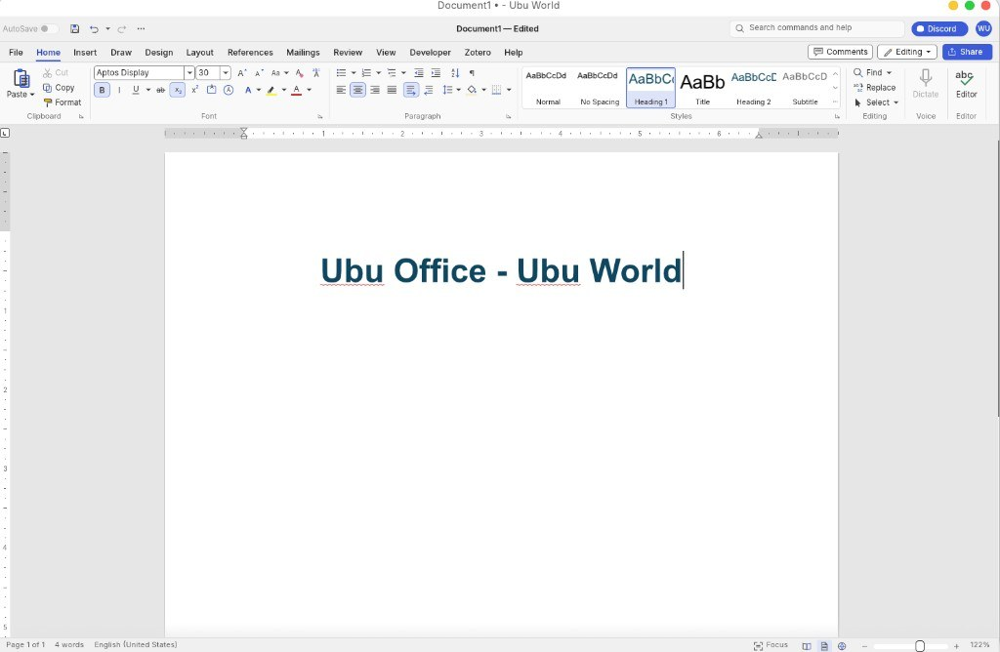
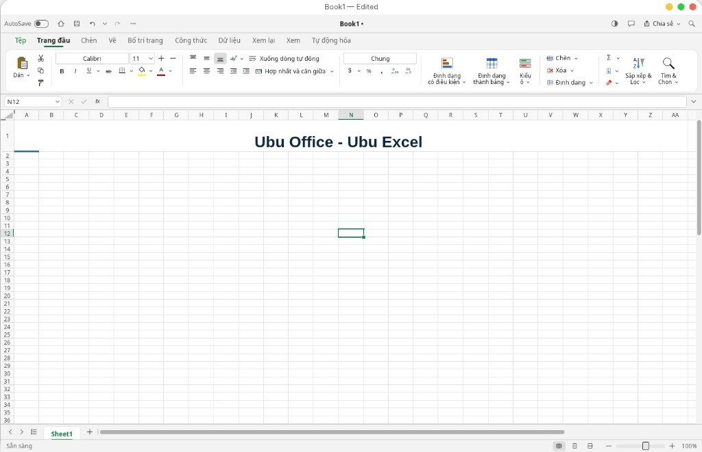
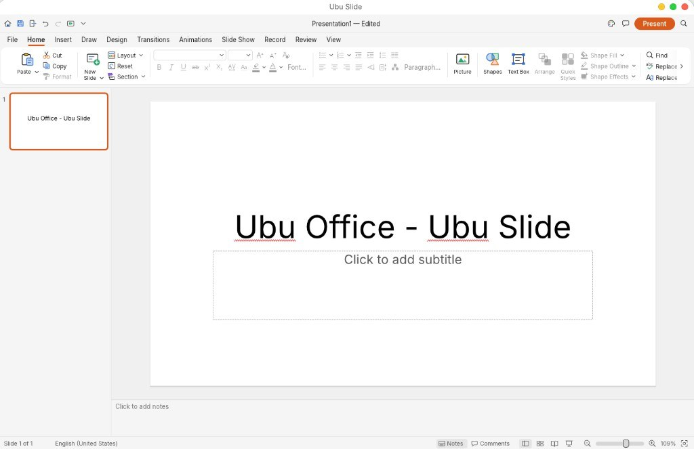
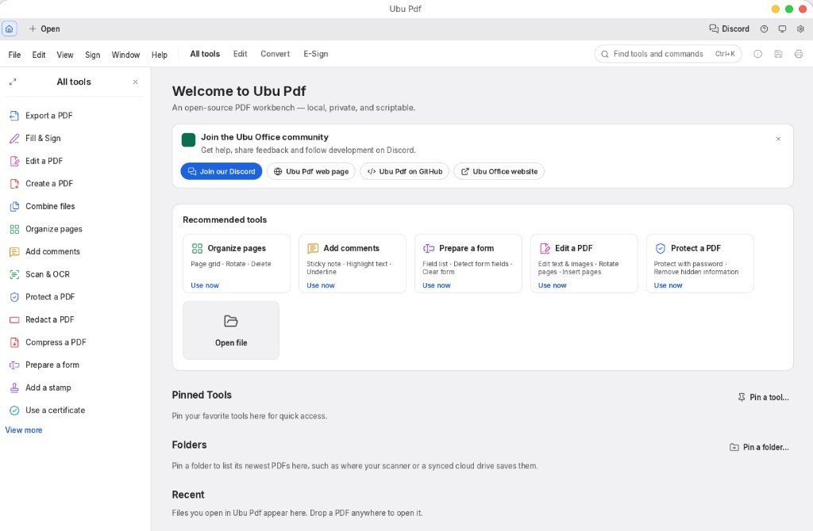

# Ubu Office — Hướng dẫn cài đặt (Tiếng Việt)

> [🇬🇧 USER GUIDE (EN)](GUIDE.md) · [README](README.md) · [⬇ Tải Release](https://github.com/manguonmocom/ubuntu-office/releases/latest)

**Ubu Office** là bộ ứng dụng văn phòng **miễn phí, mã nguồn mở** cho Ubuntu/Linux:

| Ứng dụng | Việc chính | Định dạng |
|----------|------------|-----------|
| **Ubu World** | Soạn thảo (kiểu Word) | `.docx`, ODT, RTF… |
| **Ubu Excel** | Bảng tính | `.xlsx`, CSV… |
| **Ubu Slide** | Trình chiếu | `.pptx` |
| **Ubu Pdf** | Xem / chỉnh PDF | `.pdf` |

Ứng dụng mặc định **English**. Khi cài bằng **Setup Wizard**, chọn ngôn ngữ (mặc định **Tiếng Việt**) — lần mở đầu sẽ dùng ngôn ngữ đó. File của bạn nằm trên máy — không bắt buộc tài khoản đám mây.

---

## Cách 1 — Setup AppImage (dễ nhất, khuyến nghị)

Phù hợp khi bạn **không muốn cài Python** và muốn chọn ngôn ngữ + app ngay trên giao diện.

1. Vào [Release mới nhất](https://github.com/manguonmocom/ubuntu-office/releases/latest).
2. Tải file **`Ubu-Office-Setup-…-x86_64.AppImage`**.
3. Chuột phải file → **Properties / Thuộc tính** → bật **Allow executing file as program** / **Cho phép chạy như chương trình**.
4. Nhấp đúp để mở.
5. Chọn **ngôn ngữ** (mặc định: **Tiếng Việt**).
6. Tick ứng dụng cần cài (mặc định: **cả 4**).
7. Bấm cài — xong sẽ có shortcut trong menu ứng dụng.

> Cần gói `zenity` (Ubuntu Desktop thường đã có). Nếu thiếu: `sudo apt install zenity`.

---

## Cách 2 — AppImage từng phần mềm

1. Tải các file `Ubu-World-…AppImage`, `Ubu-Excel-…`, `Ubu-Slide-…`, `Ubu-Pdf-…`.
2. Với **mỗi** file: Properties → **Allow running as a program**, rồi nhấp đúp.

Hoặc trong Terminal:

```bash
chmod +x Ubu-World-*-x86_64.AppImage
./Ubu-World-*-x86_64.AppImage
```

---

## Cách 3 — Gói `.deb` (cài vào hệ thống)

```bash
sudo apt install ./Ubu-World_*_amd64.deb
sudo apt install ./Ubu-Excel_*_amd64.deb
sudo apt install ./Ubu-Slide_*_amd64.deb
sudo apt install ./Ubu-Pdf_*_amd64.deb
```

Lệnh chạy: `ubu-world`, `ubu-excel`, `ubu-slide`, `ubu-pdf`.

---

## Đổi ngôn ngữ sau khi cài

- **World / Excel / Pdf:** Options / Preferences → **Interface language** → chọn **Tiếng Việt** (hoặc English…).
- Nếu vẫn thấy English sau khi cập nhật bản mới: xóa cấu hình cũ rồi mở lại app, ví dụ:

```bash
rm -f ~/.config/wordcraft/ui.json ~/.config/gridcraft/ui.json ~/.config/pdfcraft/ui.json
```

> **Ubu Slide:** giao diện hiện chủ yếu tiếng Anh (bản upstream chưa có bộ dịch UI đầy đủ). World / Excel / Pdf hỗ trợ Tiếng Việt.

---

## Ảnh chụp màn hình









---

## Mẹo & sự cố

- Cài driver Vulkan: `sudo apt install mesa-vulkan-drivers`
- Cửa sổ không hiện: `WGPU_BACKEND=gl ./Ubu-World-*.AppImage`
- **Không** chạy AppImage bằng `sudo`
- Kiểm tra checksum: file `checksums.sha256` trong Release

## Gỡ cài

- AppImage / Setup: xóa file AppImage và shortcut `~/.local/share/applications/com.manguonmo.ubu-*.desktop`
- `.deb`: `sudo apt remove ubu-world ubu-excel ubu-slide ubu-pdf`

## Hỗ trợ

- Website: https://manguonmo.com  
- Báo lỗi: https://github.com/manguonmocom/ubuntu-office/issues  

Giấy phép: MIT OR Apache-2.0 · © 2026 Ubu Office (manguonmo.com)
