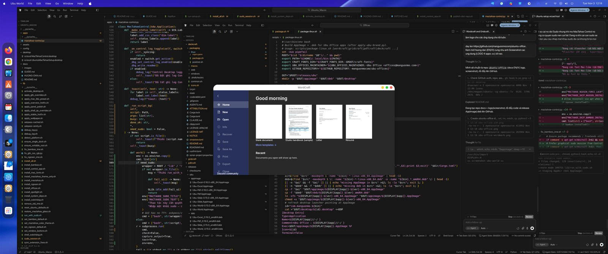
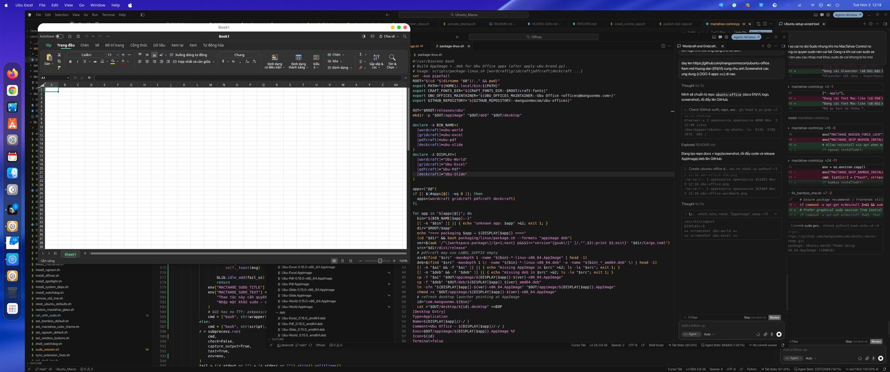
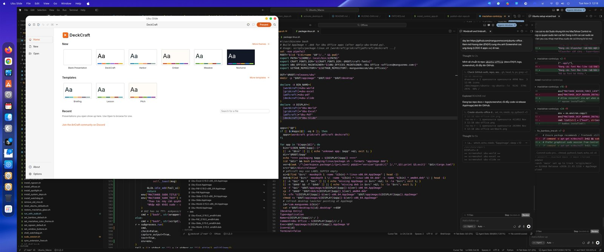
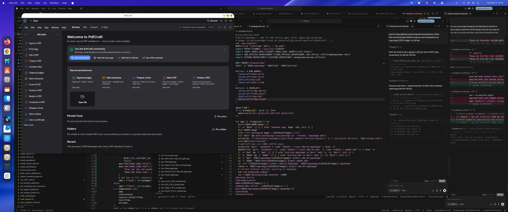

<p align="center">
  
</p>

<h1 align="center">Ubu Office</h1>

<p align="center">
  <b>Bộ ứng dụng văn phòng cho Ubuntu</b> — Word · Excel · Slide · PDF<br/>
  by <a href="https://manguonmo.com">manguonmo.com</a>
</p>

<p align="center">
  <a href="docs/GUIDE.md">English guide</a> ·
  <a href="docs/HUONG-DAN.md">Hướng dẫn tiếng Việt</a> ·
  <a href="https://github.com/manguonmocom/ubuntu-office/releases/latest">Download</a>
</p>

---

<p align="center">
  
</p>

## Apps

| | App | What it does | Formats |
|:-:|-----|--------------|---------|
|  | **Ubu World** | Word processor | `.docx`, ODT, RTF, PDF export… |
|  | **Ubu Excel** | Spreadsheet | `.xlsx`, CSV… |
|  | **Ubu Slide** | Presentations | `.pptx`… |
|  | **Ubu Pdf** | PDF reader / editor | `.pdf`… |

## Screenshots

| Ubu World | Ubu Excel |
|-----------|-----------|
|  |  |

| Ubu Slide | Ubu Pdf |
|-----------|---------|
|  |  |

## Install (Ubuntu)

### Option A — AppImage (no root)

1. Download AppImages from [Releases](https://github.com/manguonmocom/ubuntu-office/releases/latest).
2. Mark executable → double-click.

```bash
chmod +x Ubu-World-*-x86_64.AppImage
./Ubu-World-*-x86_64.AppImage
```

### Option B — `.deb` (apt)

```bash
sudo apt install ./Ubu-World_*_amd64.deb
# similarly: Ubu-Excel, Ubu-Slide, Ubu-Pdf
```

### Option C — with Ubuntu macOS Theme Setup

If you use [ubuntu-macos-theme](https://github.com/manguonmocom/ubuntu-macos-theme), tick **Ubu Office** in the Setup Wizard.

## Packages

Each release ships:

- `Ubu-World-*-x86_64.AppImage` + `Ubu-World_*_amd64.deb`
- `Ubu-Excel-*-x86_64.AppImage` + `Ubu-Excel_*_amd64.deb`
- `Ubu-Slide-*-x86_64.AppImage` + `Ubu-Slide_*_amd64.deb`
- `Ubu-Pdf-*-x86_64.AppImage` + `Ubu-Pdf_*_amd64.deb`
- `SHA256SUMS.txt`

**Maintainer:** Ubu Office \<offices@manguonmo.com\> · **Homepage:** https://manguonmo.com  
**App IDs:** `com.manguonmo.ubu-world` · `ubu-excel` · `ubu-slide` · `ubu-pdf`

## Requirements

- Ubuntu **22.04+** recommended (glibc ≥ 2.35)
- GPU with Vulkan or OpenGL (egui / wgpu)
- Normal user account — do **not** run AppImages with `sudo`

## License

MIT OR Apache-2.0. See [LICENSE-MIT](LICENSE-MIT) and [LICENSE-APACHE](LICENSE-APACHE).  
Copyright (c) 2026 Ubu Office (https://manguonmo.com).

## Links

- Website: [manguonmo.com](https://manguonmo.com)
- Theme companion: [ubuntu-macos-theme](https://github.com/manguonmocom/ubuntu-macos-theme)
- Guide EN: [docs/GUIDE.md](docs/GUIDE.md)
- Hướng dẫn VI: [docs/HUONG-DAN.md](docs/HUONG-DAN.md)
