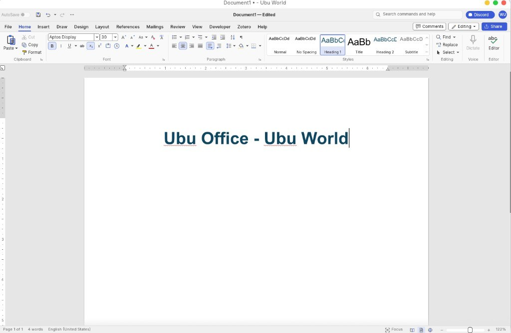
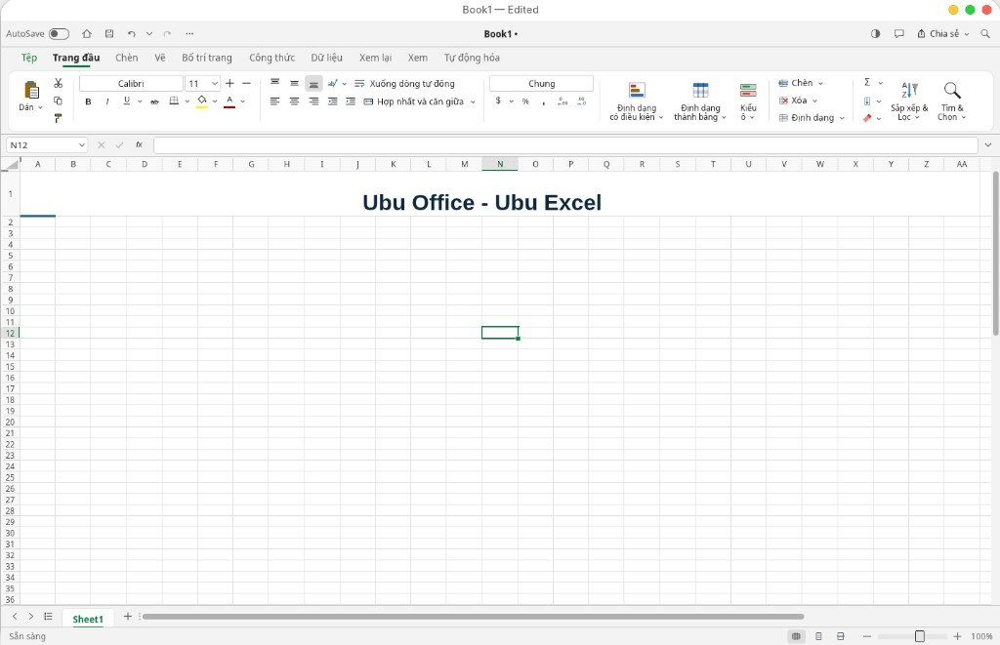
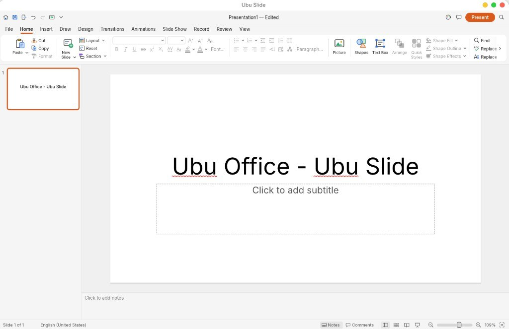
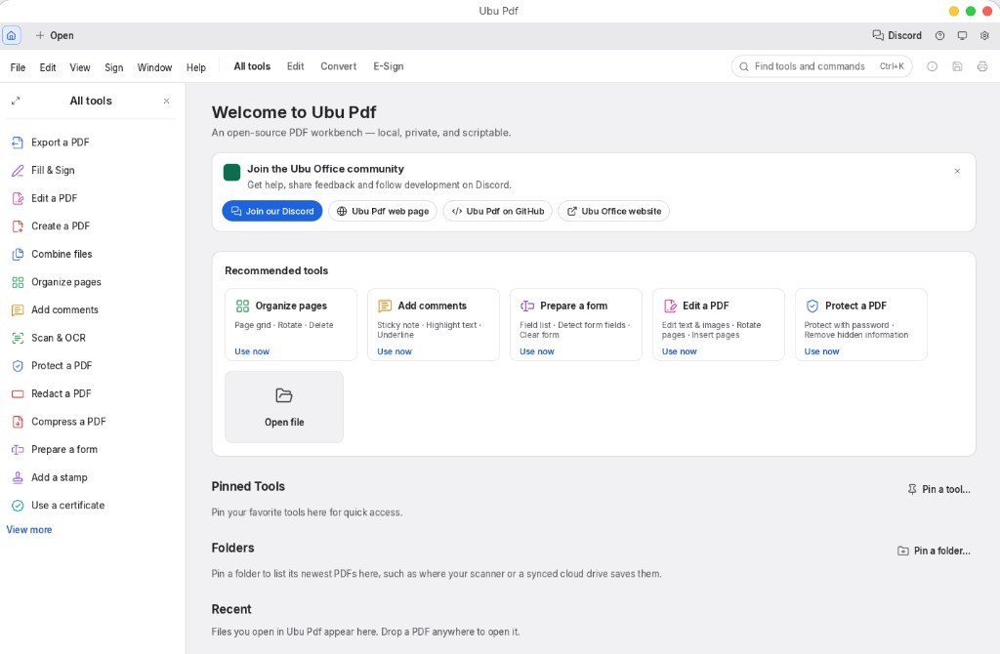

# Ubu Office — User guide (English)

> [🇻🇳 Hướng Dẫn (VI)](HUONG-DAN.md) · [README](README.md) · [⬇ Releases](https://github.com/manguonmocom/ubuntu-office/releases/latest)

**Ubu Office** is a free, open-source office suite for Ubuntu and other Linux desktops:

| App | Purpose | Formats |
|-----|---------|---------|
| **Ubu World** | Word processor | `.docx`, ODT, RTF, … |
| **Ubu Excel** | Spreadsheet | `.xlsx`, CSV, … |
| **Ubu Slide** | Presentations | `.pptx` |
| **Ubu Pdf** | PDF reader / editor | `.pdf` |

Apps default to **English**. The **Setup Wizard** can set Vietnamese (or another language) for first launch; change anytime later in Options. Your files stay on your computer — no cloud account required.

---

## Option 1 — Setup AppImage (easiest)

1. Open the [latest Release](https://github.com/manguonmocom/ubuntu-office/releases/latest).
2. Download **`Ubu-Office-Setup-…-x86_64.AppImage`**.
3. Right-click → **Properties** → enable **“Allow executing file as program”**.
4. Double-click the AppImage.
5. Choose **language** (default: Vietnamese).
6. Tick the apps to install (default: **all four**).
7. Confirm — shortcuts appear in your app menu.

Requires `zenity` (usually preinstalled on Ubuntu Desktop). If missing: `sudo apt install zenity`.

---

## Option 2 — Per-app AppImage

Download `Ubu-World`, `Ubu-Excel`, `Ubu-Slide`, and/or `Ubu-Pdf` AppImages, mark each executable, then double-click.

```bash
chmod +x Ubu-World-*-x86_64.AppImage
./Ubu-World-*-x86_64.AppImage
```

---

## Option 3 — `.deb` packages

```bash
sudo apt install ./Ubu-World_*_amd64.deb
sudo apt install ./Ubu-Excel_*_amd64.deb
sudo apt install ./Ubu-Slide_*_amd64.deb
sudo apt install ./Ubu-Pdf_*_amd64.deb
```

Commands: `ubu-world`, `ubu-excel`, `ubu-slide`, `ubu-pdf`.

---

## Language after install

- **World / Excel / Pdf:** Options / Preferences → **Interface language**.
- To reset a sticky English preference after upgrading:

```bash
rm -f ~/.config/wordcraft/ui.json ~/.config/gridcraft/ui.json ~/.config/pdfcraft/ui.json
```

> **Ubu Slide:** UI is currently English-only (upstream has no full UI translation catalogs yet). World, Excel, and Pdf ship with Vietnamese.

---

## Screenshots









---

## Tips

- Install Vulkan drivers: `sudo apt install mesa-vulkan-drivers`
- Blank window: `WGPU_BACKEND=gl ./Ubu-World-*.AppImage`
- Never run AppImages with `sudo`
- Verify downloads with `checksums.sha256`

## Uninstall

- AppImage / Setup: delete the files and `~/.local/share/applications/com.manguonmo.ubu-*.desktop`
- `.deb`: `sudo apt remove ubu-world ubu-excel ubu-slide ubu-pdf`

## Support

- https://manguonmo.com  
- https://github.com/manguonmocom/ubuntu-office/issues  

License: MIT OR Apache-2.0 · © 2026 Ubu Office (manguonmo.com)
